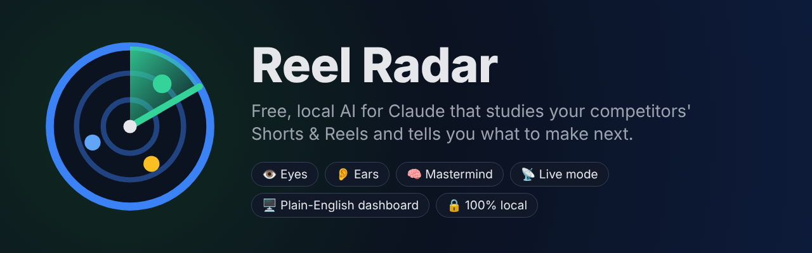
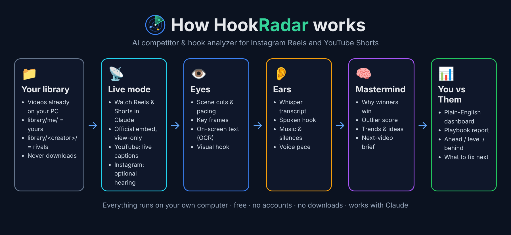
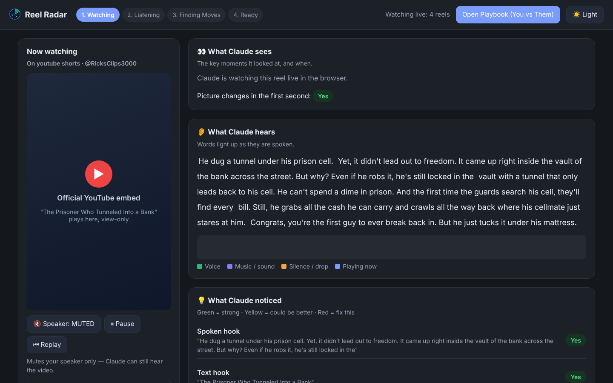
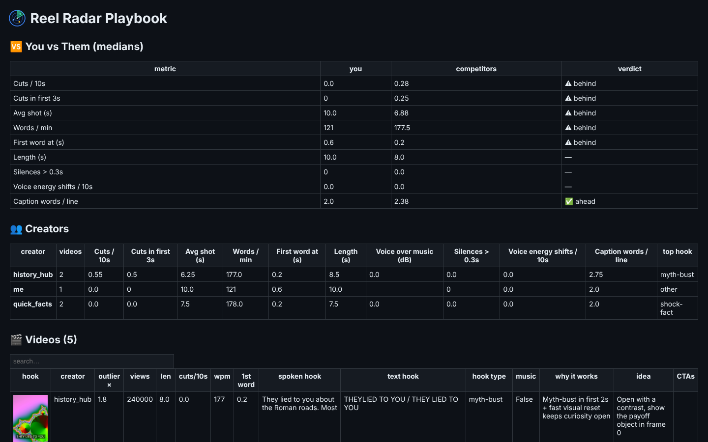

<h1 align="center"> Reel Radar</h1>

<b>A free, local AI team that studies your competitors' YouTube Shorts & Instagram Reels and tells you exactly what to make next.</b> 
Runs 100% on your PC · never downloads videos · no paid APIs · works with Claude

<i>Made by Harsh Rajput · MIT License</i>

---

## 🚀 Start in 3 clicks (no coding)
**You need:** a Windows 10/11 PC or a Mac (Mac version not fully tested yet) · the free **[Claude desktop app](https://claude.ai/download)** (sign in with a free account) · about 2 GB free space. No coding, no GPU, no paid tools.

1. **Download:** at the top of this page click the green **`<> Code`** button → **Download ZIP**. Then right-click the downloaded file → **Extract All** → **Extract**.
2. **Install:** open the extracted folder and double-click **`INSTALL_WINDOWS.bat`** (Mac: **`INSTALL_MAC.command`**). Wait until it says **Done!** (a few minutes; it installs anything missing and asks first).
   > Windows says *"Windows protected your PC"*? Click **More info → Run anyway**. Mac says *"can't be opened"*? **Right-click → Open → Open**.
3. **Start:** double-click **`START_DASHBOARD.bat`** (Mac: **`START_DASHBOARD.command`**) to open your live dashboard. Then open the **Claude desktop app**, add the Reel Radar folder (**+ → Add folder**) and type **`start`**. Claude asks 3 simple questions and you're ready.

Just want to see it work first? Type *"run the demo"* in Claude.

Developers: `git clone https://github.com/harsh-ai-tools/reel-radar.git` · Claude Code plugin: `/plugin marketplace add harsh-ai-tools/reel-radar` then `/plugin install reel-radar@harsh-ai-tools`

---

## ⚙️ How it works

## 📸 See it in action
**Live dashboard**: calm, plain-English cards · 4-step progress bar · 🔊 Speaker / Mute button · Light / Dark mode · technical log tucked under *Technical details* · 📚 replay any video it already watched

**Playbook**: You vs Them, creator profiles and every video in one page

Dashboard: real capture of Claude watching our own @historical_hq Short live, with You vs Them. Playbook: demo videos generated for testing.

---

## ✨ Features

**👁️ Eyes: what it sees**
- **Scene cuts**: every cut, cuts per 10 seconds, shot length
- **Key frames & contact sheet**: the opening seconds plus a frame after every cut
- **On-screen text**: reads captions and titles, and where they sit
- **Visual hook**: does the picture change in the first second? Is there text on frame 0?

**👂 Ears: what it hears**
- **Transcript**: every word with its exact time, in your language (tested with English, Hindi and Punjabi; Punjabi comes out in Gurmukhi)
- **Spoken hook**: exactly what's said in the first 3 seconds
- **Voice pace**: words per minute, time to first word, energy changes
- **Sound design**: music bed, voice-over-music level, silences, audio drops (re-hooks)

**🧠 Mastermind: what it learns**
- **Winning traits**: what outlier videos do differently from the rest
- **Creator style**: each competitor's hook types (needs the optional local Ollama AI), length, pacing, captions, music, CTAs
- **Outlier score**: which videos beat their creator's usual views (×2, ×10…)
- **Trend radar**: rising words and topics in your niche, weighted by performance
- **Comment ideas**: viewer questions turned into video ideas
- **Next-video brief**: targets, hook formulas, structure and sound plan

**📡 Live mode (v2.3.0)**: Claude watches in the Claude app's built-in browser, view-only, and the dashboard updates as it goes. Zero downloads.
- **YouTube Shorts**: plays through the official embed; Claude reads the on-page captions, so words light up as they're spoken
- **Instagram Reels**: plays through the official embed with Claude's visual and on-screen-text notes. Instagram has no captions, so hearing is **optional and off by default**: `radar.py hear on`, then Claude runs `radar.py hear --url URL` while the reel plays. It listens to your speakers, transcribes with Whisper and keeps only the text: the audio stays in memory and is never saved (Windows; needs `pip install soundcard`)

**📈 Retention & 🖼️ thumbnails**
- **Retention import**: drop in a YouTube Studio *Audience retention* export (CSV or the .zip). See your 3-second hold, the biggest drops, what was said or shown at each drop, and rewatch spikes
- **Thumbnail check**: contrast, colour, clutter, text amount and whether the text is still readable at phone size, with fixes and You vs Them

**✅ Create better**
- **Pre-post check**: grade your draft 0–100 against winning videos, with exact fixes
- **Originality check**: stops scripts that copy a competitor word for word
- **You vs Them**: your numbers next to theirs, marked ahead, level or behind
- **Weekly report**: outliers, gaps, trends, ideas and security in one page

**🤖 AI team (for Claude)**
| Member | Job |
|---|---|
| 🧭 Manager (`radar`) | You type plain English; it loads only the one member needed and judges ideas (go / no-go) |
| 🚀 Setup (`radar-setup`) | Type **start**: 3 questions, opens your video folder, runs the first analysis |
| ✅ Pre-post check (`radar-check`) | Grades a draft video, script or thumbnail before you post |
| 🔭 Scout | Finds the right competitors for your niche (you approve) |
| 👀 Live Watcher | Watches Reels/Shorts in the Claude app's built-in browser, view-only, and logs them to the dashboard |
| 🧠 Mastermind | Learns why competitors grow and writes your brief |
| ✍️ Scriptwriter | Writes hooks and scripts in your voice |
| ✂️ Video Editor | Timecoded edit plan: cuts, captions, sound |
| ▶️ YouTube Manager | Titles, descriptions, hashtags, thumbnails |
| 📸 Instagram Manager | Captions, hashtags, covers, collabs |
| 📈 Coach | Learns from your real results after posting |
| 🛡️ Security Hook | Not an AI: local code that blocks downloads, login pages and unsafe sites *before* they happen, 0 tokens. `radar.py audit` gives PASS / FAIL |

**Token-light:** all video maths runs in local Python. Claude only reads a one-line-per-video `out/summary.json`, and unchanged videos are never re-analysed.

**🔒 Safety & privacy**
- **View-only:** never downloads, uploads, likes, follows, comments or DMs
- **Your files:** only reads videos already in your `library/` folder, and never deletes them
- **Live watching:** the Guard approves every page *before* it opens: only YouTube and Instagram, never login or account pages, at human pace (100 videos/hour, 4 s apart; adjustable)
- **Your data stays on your PC:** no accounts, no cloud, no tracking. The AI verdict runs on a local Ollama only, unless you add `--allow-remote-ai`
- **Private dashboard:** a new secret link each time; other websites and other devices can't read it
- **No secrets saved:** detects 10+ key/password/token formats; `radar.py audit` checks every run
- **Other people's privacy:** emails, phone numbers, @usernames and links in pasted comments are hidden
- **Delete anytime:** `python radar.py forget "creator"` or `python radar.py forget --all`

---

## 🔭 Scout setup: find competitors (optional, 5 minutes)
**No setup needed:** just ask Claude *"Scout competitors for my niche"*. It searches the web and shows you a list to approve.
**Want faster, exact numbers (subscribers, views per video)?** Add a free YouTube key once:

1. Open [console.cloud.google.com](https://console.cloud.google.com/) and sign in with any Google account.
2. Top bar → **Select a project → New project** → name it `reel-radar` → **Create**.
3. Search bar → type **YouTube Data API v3** → open it → **Enable**.
4. Left menu → **APIs & Services → Credentials → + Create credentials → API key** → **Copy** (it starts with `AIza`).
5. *(Recommended)* Click the key → **API restrictions → Restrict key → YouTube Data API v3** → **Save**.
6. In the Reel Radar folder, double-click **`SET_YOUTUBE_KEY.bat`** (Windows) or **`SET_YOUTUBE_KEY.command`** (Mac) and paste the key. It's hidden while you paste and saved only in your computer's settings, never in Reel Radar's files.
7. Ask Claude *"Scout competitors for my niche"* (or run `python radar.py scout`). Approve the ones you like.

Check it worked: `python radar.py doctor` shows **✅ YouTube key for Scout**. It's free: one Scout run uses about 1% of the daily free quota. Never paste the key into the chat.

## 💬 How to use it (what to type in Claude)
**First time:** open Claude in the Reel Radar folder (or install the plugin) and type **`start`**: 3 questions and you're set up. Double-click **`START_DASHBOARD`** to watch Claude work live.

Then just type plain English:

| Goal | Type this |
|---|---|
| Find competitors | *"Scout competitors for my niche"* |
| Study YouTube | *"Watch the latest 5 Shorts from @creator live"* |
| Study Instagram | *"Watch these Reels: [paste links]"* or *"Watch @creator's last 3 Reels"* |
| Hear Instagram audio | *"Turn on Instagram hearing and listen to this Reel"* (Windows) |
| Compare | *"Watch 3 of my own Reels too and show You vs Them"* |
| Get ideas | *"Why is @creator growing? Give me my next video idea"* |
| Create | *"Write the script for that idea"* → *"Check my draft before I post"* |

**Do I need to log in?**
- **YouTube:** no. Public Shorts and their captions work without an account.
- **Instagram:** yes, once, by **you**. Instagram hides most Reels from logged-out visitors, so sign in to Instagram yourself in the Claude app's built-in browser. Claude never types passwords or opens login pages, and only watches (no likes, follows, comments or downloads).
- Live mode needs the **Claude desktop app** (it uses the app's built-in browser).

## 🧰 Commands
| Command | What it does |
|---|---|
| `python radar.py doctor` | Health check with one-line fixes |
| `python radar.py demo` | 15-second sample run |
| `python radar.py init` | Set niche, language, platforms, competitors |
| `python radar.py watch` | Analyse new videos with the live dashboard |
| `python radar.py brief "topic"` | Next-video brief from winning videos |
| `python radar.py precheck draft.mp4` | Grade a draft before posting |
| `python radar.py originality script.txt` | Check a script isn't copied |
| `python radar.py trends` / `ideas` / `patterns` | Trends, comment ideas, what winners do |
| `python radar.py weekly` | Everything in one weekly report |
| `python radar.py scout` / `approve "name"` | Find & approve competitors |
| `python radar.py retention export.zip --video library/me/x.mp4` | Where viewers leave and why (YouTube Studio export) |
| `python radar.py thumbs` | Score thumbnails in `library/<creator>/thumbnails/` |
| `python radar.py stats-template` | Create `stats.csv` to add views (for outlier scores) |
| `python radar.py hear on` / `hear --url URL` | Optional Instagram hearing (off by default; Windows) |
| `python radar.py audit` | Security check: PASS / FAIL |
| `python radar.py forget "name"` / `--all` | Delete analysis data (your videos stay) |

**Options:** `--gpu` (NVIDIA, faster speech-to-text) · `--ollama qwen2.5vl:3b` (free local AI verdict via [Ollama](https://ollama.com)) · `--whisper base` (faster on slow laptops) / `medium` (more accurate)

## 🩺 Troubleshooting
- **Anything wrong?** Run `python radar.py doctor` (or ask Claude "run doctor") and follow the ❌ line.
- **"ffmpeg is missing"** → run the installer again and say **yes** to ffmpeg.
- **Slow on an old laptop** → add `--whisper base`. No GPU needed.
- **Dashboard didn't open** → it picks the next free port by itself; copy the link printed in the window.
- **No on-screen text found** → OCR is optional; Claude reads the text from the contact sheets instead.
- Still stuck? [Open a bug report](https://github.com/harsh-ai-tools/reel-radar/issues/new?template=bug_report.md) with your `doctor` output.

## 🗺️ Roadmap
- [x] Eyes, ears, live dashboard, You vs Them
- [x] AI team with a 0-token Security Hook
- [x] Mastermind: patterns, briefs, trends, comment ideas, weekly report
- [x] Pre-post check and originality check
- [x] One-click installer + Claude plugin
- [x] Retention-curve import from YouTube Studio exports
- [x] Thumbnail analysis (contrast, clutter, text, phone-size legibility)
- [x] Live mode: YouTube Shorts with live captions, Instagram Reels (visual notes + optional hearing)

> ⚠️ For study only. Don't re-upload other creators' videos or copy their scripts. AI output is a draft: verify facts before posting.
